# AI Agents Actions

Through Syskit Point, you can get a unified inventory of the Microsoft agents and Entra apps that can access your Microsoft 365 data. 

To help you manage them, the following actions and reports are available in Syskit Point:

* **Agent actions**
  * [Block and Unblock](#block-and-unblock)
  * [Reassign](#reassign)
  * [Delete](#delete-agent)
* **Agent reports**
  * [Knowledge Sources](#knowledge-sources)
  * [Tools](#tools)
  * [Topics](#topics)
  * [Agent Activity](#agent-activity)
  * [Agent Configuration Changes](#agent-configuration-changes)
* **App actions**
  * [Block sign-in and Allow sign-in](#block-sign-in-and-allow-sign-in)
  * [Delete](#delete-app)
* **App reports**
  * [App Activity](#app-activity)
  * [App Configuration Changes](#app-configuration-changes)

**Actions make changes** to your agents and apps in Microsoft 365, while **reports open a detailed view** of the selected agents or apps without changing anything.

These actions and reports help you stop users from using agents, stop apps from signing in to your tenant, resolve ownerless agents by assigning a new owner, review what your agents and apps use and how they are used, and remove agents and apps that are no longer needed.

* [Take a look at the Agents Inventory Report article for more details on the agents report.](ai-agents-and-apps-agents-inventory.md)
* [Take a look at the Apps Inventory Report article for more details on the apps report.](ai-agents-and-apps-apps-inventory.md)

## Agent Actions

Agent actions can be completed on the **Agents Inventory** report and on the **agent details screen**.

To complete agent actions, **you need permission to manage the agent** in Microsoft 365.

You can access the Agents Inventory report by:

* **Clicking View all agents** on the [AI & app governance Dashboard tile](ai-agents-and-apps-dashboard-tile.md)
* **Clicking the Reports button** located on the left side of the screen, **selecting the AI Agents category** in the filter in the upper left corner, and **clicking the Agents Inventory report tile** to generate the report

To open the agent details screen, **click the agent name** on the Agents Inventory report.

### Block and Unblock

The Block and Unblock actions can be completed for **Copilot Studio** and **Agent Builder** agents.

* **Block** an agent to stop people from using it.
* **Unblock** an agent to make it available again.

Once you generate the Agents Inventory report:

* **Selecting one or more agents** lets you complete **the Block or Unblock action**
  * The **Block action (1)** is available for agents that are not blocked
  * The **Unblock action (2)** is available for agents that are already blocked
* **Clicking the Block or Unblock action** opens the confirmation dialog
  * When you select multiple agents, the dialog title and the confirmation button show the number of agents the action applies to
* **Confirm the action** to block or unblock the selected agents

On the agent details screen, the Block or Unblock action is available depending on whether the agent is already blocked.

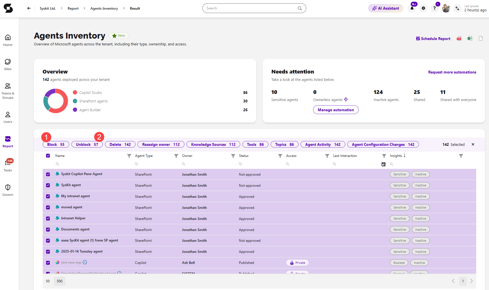

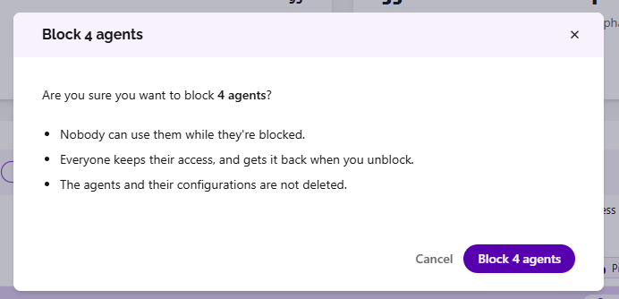

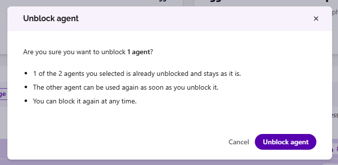

### Reassign

The Reassign owner action can be completed for **Copilot Studio** and **Agent Builder** agents. It lets you assign a new owner to an agent, which can come in handy for ownerless agents.

* To assign new owners to ownerless agents automatically, [take a look at the Ownerless Agents Automation article.](ai-agents-and-apps-automation.md)

Once you generate the Agents Inventory report:

* **Selecting one agent** lets you complete **the Reassign owner action (1)**
  * You can also select multiple agents to reassign them at once
* **Clicking the Reassign owner action** opens the confirmation dialog where you can **select the new owner(s) (2)**
* **Click the Reassign owner button (3)** to set the new owner(s) of the agent once you've made your choice

Note that the new owner must have access to the Power Platform environment where the agent is located.

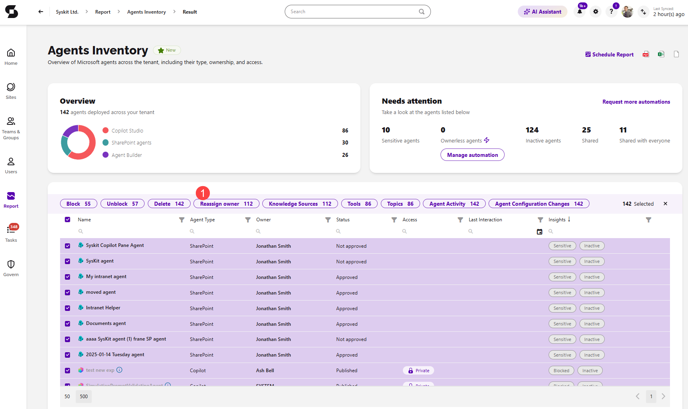

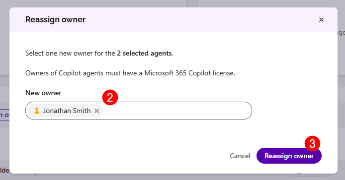

### Delete Agent

The Delete action helps you remove agents that are no longer needed. It can be completed for **Copilot Studio**, **Agent Builder**, and **SharePoint** agents.

* For SharePoint agents, the agent file is deleted from the site where it is stored.

Once you generate the Agents Inventory report:

* **Selecting an agent** lets you complete **the Delete action (1)**
* **Clicking the Delete action** opens the confirmation dialog
* **Type Delete (2)** in the designated area to confirm your choice
* **Click the Delete agent (3)** button to delete the agent

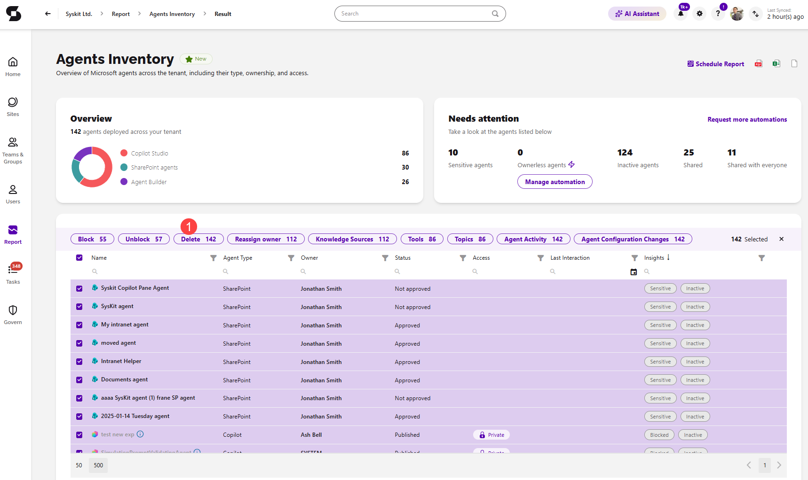

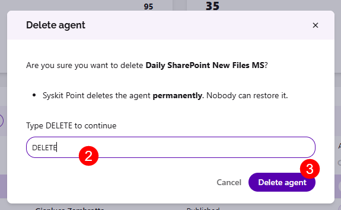

## Agent Reports

Agent reports can be opened from the **Agents Inventory** report by selecting one or more agents. They show more details about the selected agents and don't make any changes to them.

### Knowledge Sources

The Knowledge Sources action opens a list of all the knowledge sources the selected agent uses.

Once you generate the Agents Inventory report, **select an agent** and **click the Knowledge Sources action (1)** to open the list. For each source, you can see its:

* **Name**
* **Type**
* **Location**
* **Sensitivity Label**

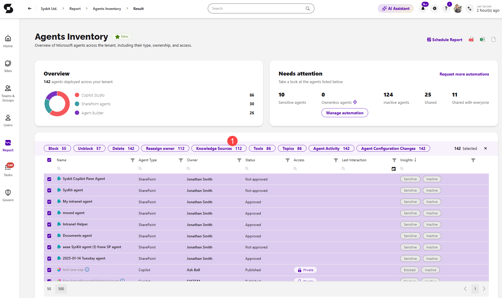

### Tools

The Tools action opens a list of all the tools the selected agents use, grouped by agent.

Once you generate the Agents Inventory report, **select one or more agents** and **click the Tools action (1)** to open the list. For each tool, you can see its:

* **Tool** name
* **Type** - for example, Connector, Model Context Protocol, or Agent
* **Enabled** - whether the tool is enabled

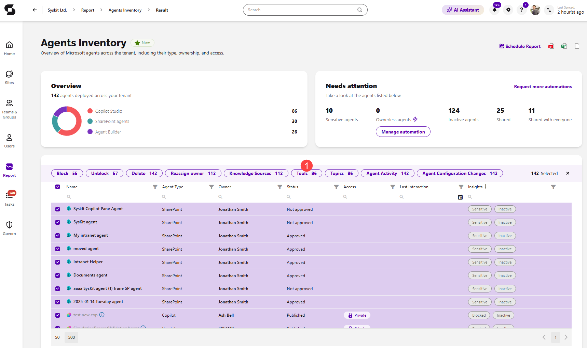

### Topics

The Topics action opens a list of all the topics the selected agents use, grouped by agent.

Once you generate the Agents Inventory report, **select one or more agents** and **click the Topics action (1)** to open the list. For each topic, you can see its:

* **Topic** name
* **Trigger** - for example, Phrases or System
* **Type** - Custom or System
* **Enabled** - whether the topic is enabled

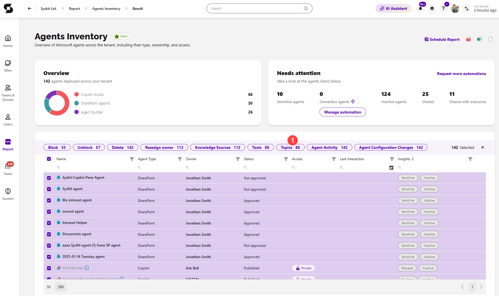

### Agent Activity

:::info
**The Agent Activity and Agent Configuration Changes reports** are available in the Security & Compliance plan and higher tiers. See the [pricing page](https://www.syskit.com/products/point/pricing/) for more details.
:::

The Agent Activity action opens the **Agent Activity** report, which shows how users interact with the selected agents, for example, **Interacted with Copilot**.

Once you generate the Agents Inventory report, **select one or more agents** and **click the Agent Activity action (1)** to open the report. The report opens on the **Last 30 Days** view, and for each activity, you can see its:

* **Date**
* **Activity**
* **Agent**
* **Performed By**
* **Item**
* **IP Address**
* **Additional Info**

Expanding a row shows more details about the activity. The Agent Activity report can be **exported as PDF, XLSX, and CSV files**. There is also the **option to schedule the report**.

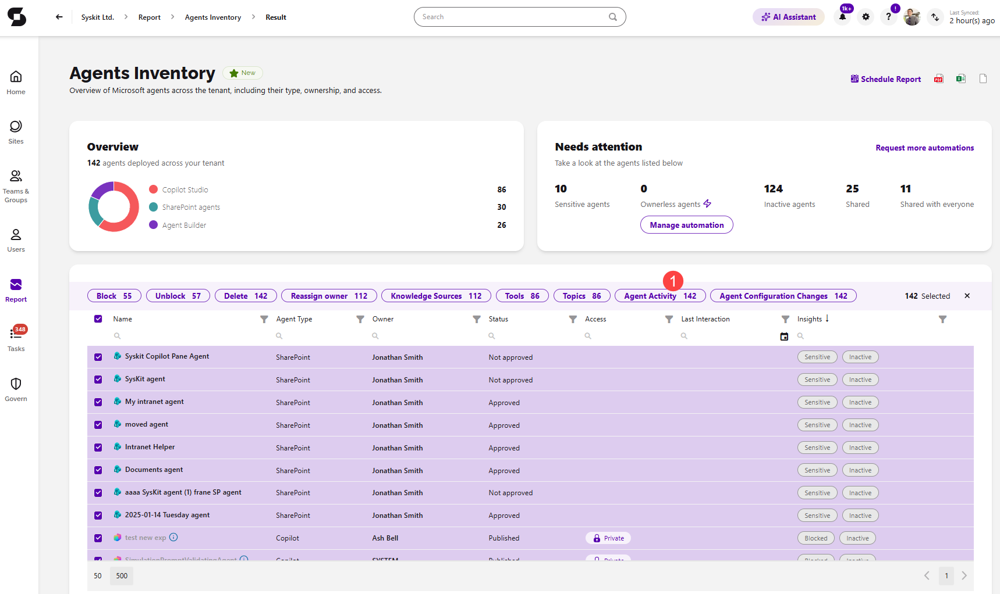

### Agent Configuration Changes

The Agent Configuration Changes action opens the **Agent Configuration Changes** report, which shows the changes made to the selected agents, such as **Blocked agent** and **Unblocked agent**, together with the changes made to the agent's identity in Microsoft Entra, such as **Updated service principal**.

Once you generate the Agents Inventory report, **select one or more agents** and **click the Agent Configuration Changes action (1)** to open the report. The report opens on the **Last 30 Days** view, and for each change, you can see its:

* **Date**
* **Activity**
* **Agent**
* **Performed By**
* **IP Address**
* **Additional Info**

Expanding a row shows more details about the change. The Agent Configuration Changes report can be **exported as PDF, XLSX, and CSV files**. There is also the **option to schedule the report**.

## Entra App Actions

Entra App actions can be completed on the **Apps Inventory** report and on the **app details screen**.

You can access the Apps Inventory report by:

* **Clicking View all apps** in the Apps section of the [AI & app governance Dashboard tile](ai-agents-and-apps-dashboard-tile.md)
* **Clicking the Reports button** located on the left side of the screen, **selecting the AI Agents category** in the filter in the upper left corner, and **clicking the Apps Inventory report tile** to generate the report

To open the app details screen, **click the app name** on the Apps Inventory report.

On the app details screen, any app actions taken apply only to that app.

### Block sign-in and Allow sign-in

* **Block sign-in** stops the app from signing in to your tenant.
* **Allow sign-in** lets the app sign in to your tenant again.

Which of the two actions is available depends on the app's current sign-in state:

* The **Block sign-in action (1)** is available for apps that can currently sign in.
* The **Allow sign-in action** is available for apps whose sign-in is blocked.

Once you generate the Apps Inventory report:

* **Selecting one or more apps** lets you complete **the Block sign-in or Allow sign-in action**.
* **Clicking the Block sign-in or Allow sign-in action** opens the confirmation dialog that lists the selected apps and the sign-in state that will be applied.
  * For multi-tenant apps, the dialog explains that the action affects only the enterprise application in your tenant, not the publisher's app registration or other tenants.
* **Confirm the action** to apply the new sign-in state.

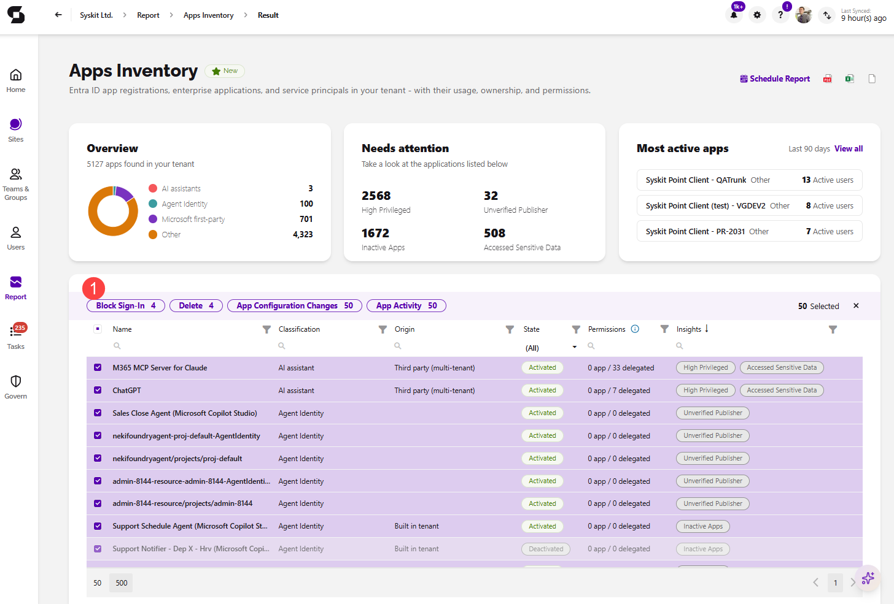

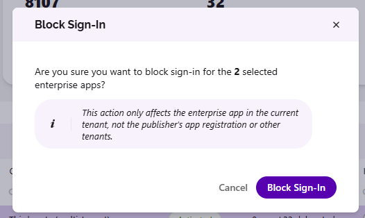

### Delete App

The Delete action helps you remove apps that are no longer needed.

* For **apps registered in your tenant**, both the app registration and its enterprise application are deleted.
* For **multi-tenant apps**, only the enterprise application in your tenant is deleted, as the publisher's app registration is located outside your tenant.

Once you generate the Apps Inventory report:

* **Selecting one or more apps** lets you complete **the Delete action (1)**.
* **Clicking the Delete action** opens the confirmation dialog that describes what will be deleted for the selected apps.
* **Type Delete (2)** to confirm you want to delete the apps.
* **Click the Delete applications (3)** button to finalize your decision.

When you delete an app from the app details screen, you are returned to the Apps Inventory report once the action is completed.

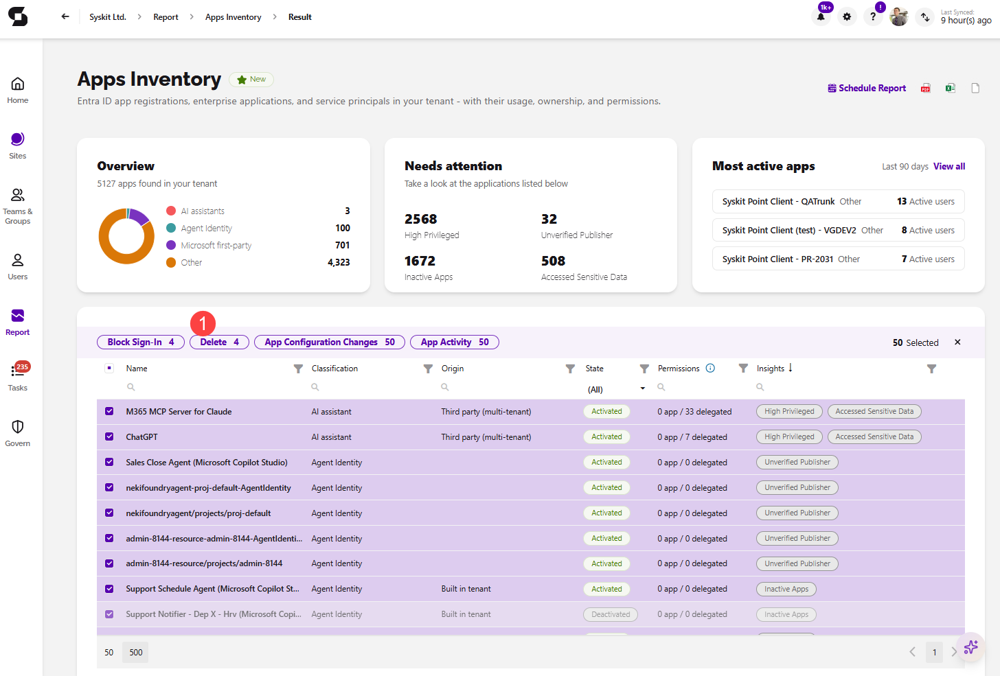

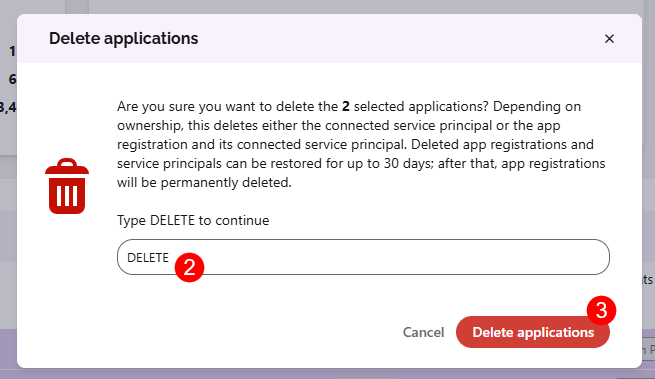

## App Reports

App reports can be opened from the **Apps Inventory** report by selecting one or more apps. They show more details about the selected apps and don't make any changes to them.

### App Activity

:::info
**The App Activity and App Configuration Changes reports** are available in the Security & Compliance plan and higher tiers. See the [pricing page](https://www.syskit.com/products/point/pricing/) for more details.
:::

The App Activity action opens the **App Activity** report, which shows everything the selected apps did, including the files they accessed, who they acted for, and sign-ins to them, for example, **Modified file** or **User logged in**.

Once you generate the Apps Inventory report, **select one or more apps** and **click the App Activity action (1)** to open the report. The report opens on the **Last 30 Days** view, and for each activity, you can see its:

* **Date**
* **Activity**
* **App**
* **Performed By**
* **Workload**
* **Item**
* **IP Address**
* **Additional Info**

Expanding a row shows more details about the activity. The App Activity report can be **exported as XLSX and CSV files**. There is also the **option to schedule the report**.

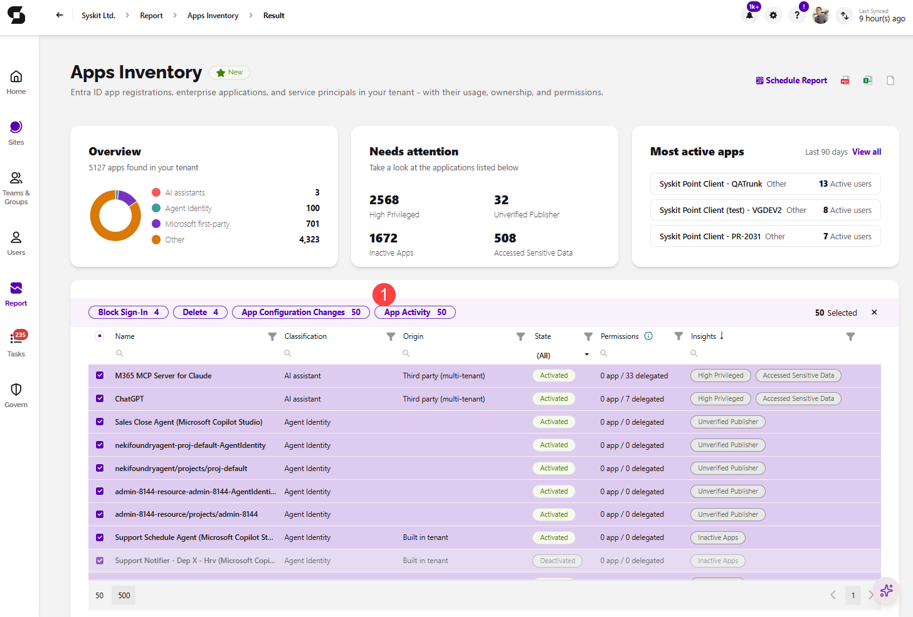

### App Configuration Changes

The App Configuration Changes action opens the **Entra App Configuration Changes** report, which shows the changes made to the selected apps in Microsoft Entra, including permissions, consent, credentials, and owners, for example, **Updated service principal**.

Once you generate the Apps Inventory report, **select one or more apps** and **click the App Configuration Changes action (1)** to open the report. For each change, you can see its:

* **Date**
* **Activity**
* **App**
* **Performed By**
* **IP Address**
* **Additional Info**

Expanding a row shows more details about the change. The Entra App Configuration Changes report can be **exported as XLSX and CSV files**. There is also the **option to schedule the report**.

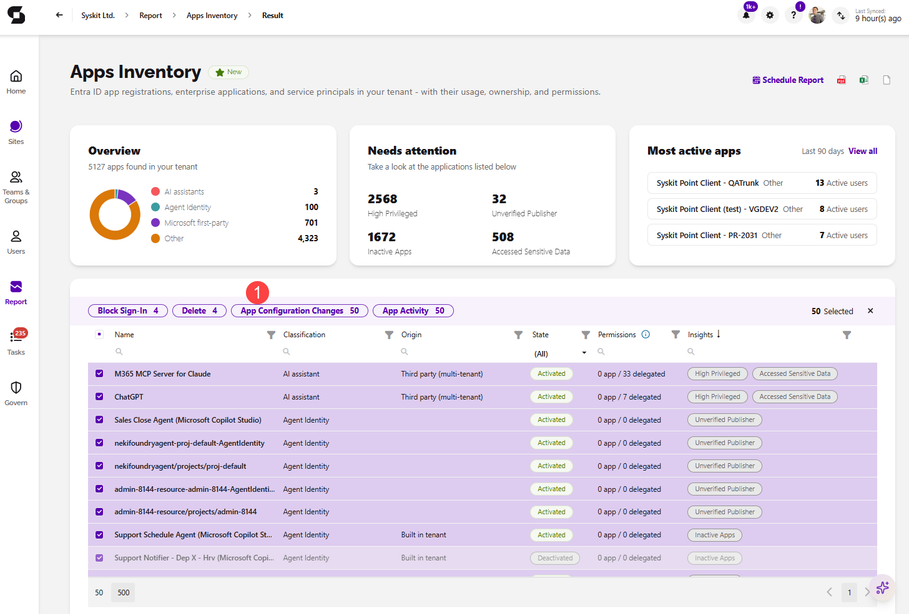

## Related Articles

* [AI Agents Overview](ai-agents-and-apps-overview.md)
* [Configure AI Agents](ai-agents-and-apps-settings.md)
* [AI & app governance Dashboard tile](ai-agents-and-apps-dashboard-tile.md)
* [Agents Inventory Report](ai-agents-and-apps-agents-inventory.md)
* [Apps Inventory Report](ai-agents-and-apps-apps-inventory.md)
* [Ownerless Agents Automation](ai-agents-and-apps-automation.md)
