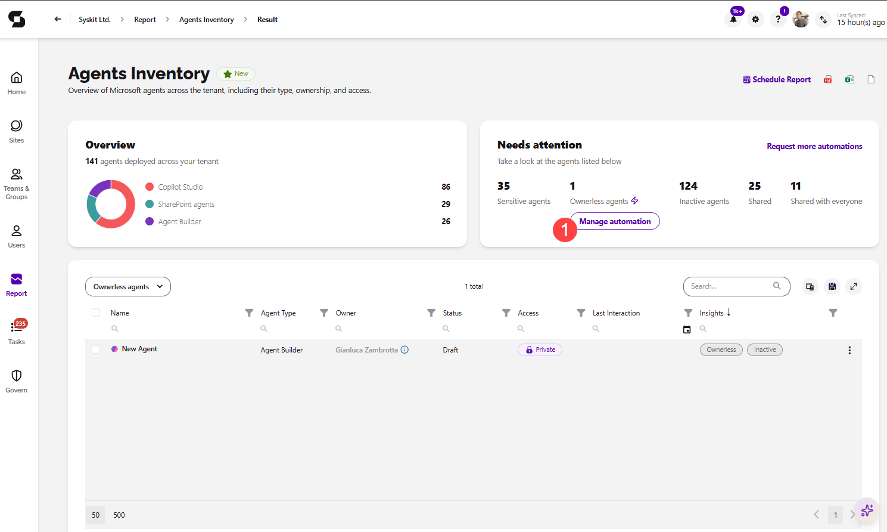
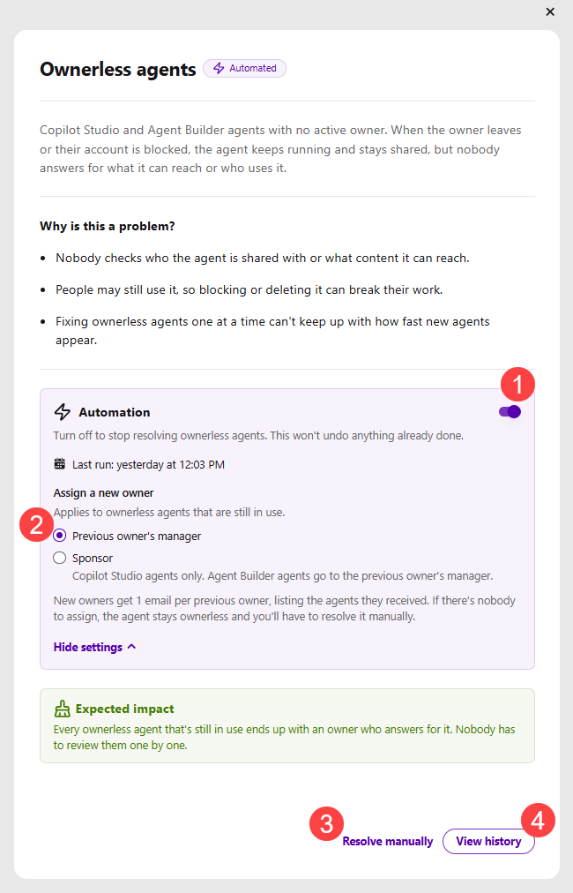

# Ownerless Agents Automation

:::info
**The Ownerless agents automation** is available in the Governance plan and higher tiers. See the [pricing page](https://www.syskit.com/products/point/pricing/) for more details.
:::

The **Ownerless agents automation** helps you keep every Copilot Studio and Agent Builder agent in your tenant accounted for. When turned on, Syskit Point automatically assigns a new owner to ownerless agents that are still in use, so every agent has someone who is responsible for it.

## Ownerless Agents Explained

**Ownerless agents are Copilot Studio and Agent Builder agents with no active owner.** This happens when the owner leaves your organization or their account is blocked. The agent keeps running and stays shared with the same people, but nobody answers for what it can reach or who uses it.

Over time, ownerless agents can accumulate silently: nobody checks who the agent is shared with or what content it can reach, and since people may still use the agent, blocking or deleting it can break their work. Fixing ownerless agents one at a time also can't keep up with how fast new agents appear. Assigning a new owner keeps the agent available to the people who use it, while making sure someone is responsible for it.

## Prerequisites

To set up the Ownerless agents automation:

* [AI Agents need to be configured](ai-agents-and-apps-settings.md) in Syskit Point
* The service account used for AI Agents needs the **Power Platform Administrator** role
  * The **AI Reader** role is enough to view agents in Syskit Point reports, but the automation needs the Power Platform Administrator role to assign new owners

## Set Up Ownerless Agents Automation

The Ownerless agents automation is set up from the [Agents Inventory](ai-agents-and-apps-agents-inventory.md) report. You can open the report in two ways:

* From the **Dashboard**:
  * Go to the [AI & app governance Dashboard tile](ai-agents-and-apps-dashboard-tile.md) and **click the Ownerless count** under Agents
  * The Agents Inventory report opens on the **Ownerless agents** view, which you can see in the view dropdown above the report grid
* From the **Report Center**:
  * **Click the Reports button** on the screen's left side
  * **Select the AI Agents category in the filter** in the upper left corner
  * **Click the Agents Inventory report tile** to open the report

Once the report opens, the **Needs attention** tile shows the number of ownerless agents, **click Manage automation (1)** to start.

After selecting Manage automation, the **information dialog** opens, providing more details on ownerless agents and leaving you with the following options:

* **Turning on the Automation toggle (1)** lets Syskit Point assign a new owner to ownerless agents for you automatically
  * Once the automation is turned on, the **Automated** label is shown next to the dialog title, and **Last run** shows when the automation last ran
  * Turning off the toggle stops resolving ownerless agents automatically, but it doesn't undo anything the automation has already done
* **Under Assign a new owner (2)**, select who becomes the new owner of ownerless agents that are still in use:
  * **Previous owner's manager** - the manager of the agent's previous owner becomes the new owner
  * **Sponsor** - the agent's sponsor becomes the new owner
    * This option is available for **Copilot Studio agents only**; Agent Builder agents are assigned to the previous owner's manager
* **Clicking Resolve manually (3)** opens the [**Agents Inventory** report](ai-agents-and-apps-agents-inventory.md) filtered to ownerless agents
  * Selecting an agent lets you complete the [**Reassign owner** action](ai-agents-and-apps-actions.md#reassign)
* **Clicking View history (4)** opens the [**Ownerless agents history** report](#ownerless-agents-history-report), where every resolved ownerless agent is stored

:::info

**Please note:**
* New owners receive **one email per previous owner**, listing the agents they received.
* **If there's nobody to assign**, the agent stays ownerless and needs to be resolved manually.

:::

## Ownerless Agents History Report

The **Ownerless agents history** report shows every ownerless agent that has been resolved, either by the automation or manually, and what happened to it.

To open the report, **click View history** in the Ownerless agents information dialog.

### Report Data

Once the report is generated, **the Overview tile** at the top summarizes how ownerless agents have been resolved, with numbers showing the amount for the following:

* **Ownerless agents resolved** - the total number of resolved ownerless agents
* **Reassigned to manager** - agents assigned to the previous owner's manager
* **Reassigned to sponsor** - agents assigned to the agent's sponsor
* **Manually reassigned** - agents that were reassigned manually

Below the numbers, a bar shows the share of ownerless agents resolved **Automated** and **Manual**, in percentages.

Use the view selector above the grid to show the history for the **Last 30 days**, **Last 3 months**, **Last 6 months**, or a **custom** period.

The report grid shows the following columns:

* **Name** of the agent
* **Agent type** - Copilot Studio or Agent Builder
* **Action** - the action taken on the agent, for example, Reassign
* **Status** - the outcome of the action: Success, Warning, or Error
* **Previous owner** - the owner before the agent became ownerless
* **New owner** - the user who became the new owner of the agent
* **Resolved on** - the date and time when the agent was resolved
* **Method** - whether the agent was resolved **Automated** or **Manual**
* **Resolved by** - Syskit Point for agents resolved by the automation, or the user who resolved the agent manually

The Ownerless agents history report can be **exported as PDF, CSV and XLSX files**.

## Related Articles

* [AI Agents Overview](ai-agents-and-apps-overview.md)
* [Configure AI Agents](ai-agents-and-apps-settings.md)
* [Agents Inventory Report](ai-agents-and-apps-agents-inventory.md)
* [AI Agents Actions](ai-agents-and-apps-actions.md)
