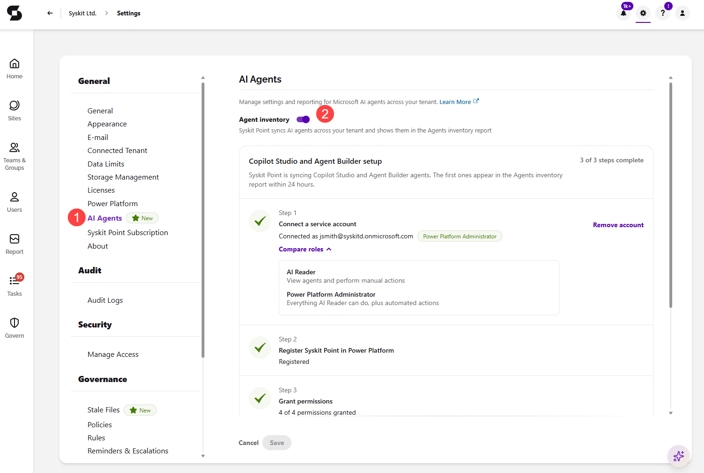
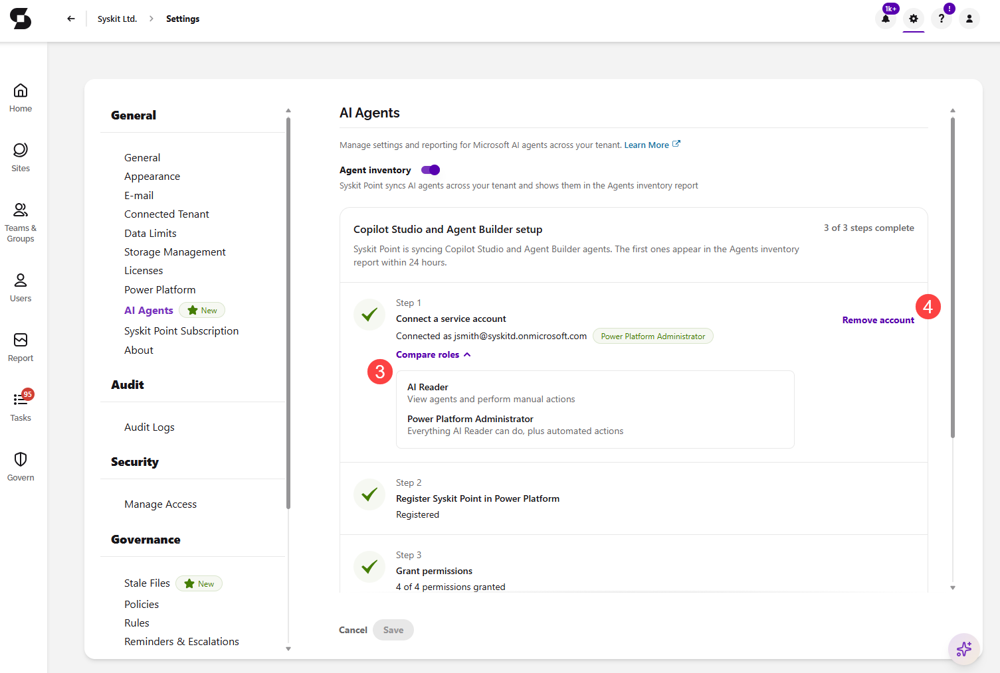

# Configure AI Agents

In order to start discovering the **Microsoft agents and Entra apps that can access your Microsoft 365 data**, you need to first set up **AI Agents** in Syskit Point. During the setup, you connect a service account and grant Syskit Point the permissions it needs to read the agents across your tenant. This helps you keep track of the agents and Entra apps in one place through the [Agents Inventory](ai-agents-and-apps-agents-inventory.md) and [Apps Inventory](ai-agents-and-apps-apps-inventory.md) reports.

In this article, you can find details on:

* [Prerequisites](#prerequisites)
* [Set Up AI Agents](#ai-agents-in-settings)

## Prerequisites

To set up and configure AI Agents: 

* You need the Global Administrator role.
* You need a **service account** with the **AI Reader** or **Power Platform Administrator** role assigned.
  * Syskit Point signs in with this account to read the agents across your tenant.
  * The service account doesn't need the Global Administrator role.
  * The **AI Reader** role is enough to view agents in Syskit Point reports, while the **Power Platform Administrator** role is required only if you want to use the [Ownerless agents automation](ai-agents-and-apps-automation.md).

## AI Agents in Settings

To configure AI Agents, go to the **AI Agents section (1)** of Settings, under **General**. 

* **Turn on the toggle for Agent inventory (2)** 
  * When enabled, AI agents across your tenant are synced, displayed in the agent inventory, and available for reporting. 

The rest of the AI Agents settings consists of two parts: **connecting a service account** and **granting the agent configuration permissions**.

:::info

The service account and Power Platform permissions are only required to discover **Copilot Studio** and **Agent Builder** agents. **SharePoint agents** and **Entra apps** are synced by default and don't require any additional setup.

:::

### Connect the Service Account

Syskit Point uses the **service account** connected in the AI Agents settings to sign in and read the agents across your tenant. The account **must have the AI Reader or Power Platform Administrator** role.

* **We recommend connecting a service account dedicated to AI Agents**, separate from the service account Syskit Point uses to collect the rest of your tenant data.
  * This way, each service account has a single purpose, which is often required by company security policies.
* **Click Connect account** and sign in with the service account. The sign-in is completed without leaving the settings screen.
* Once connected, the **Status** shows the **connected account** with its **assigned role (3)**.
  * **AI Reader** - lets you view agents in Syskit Point reports and perform manual actions on them.
  * **Power Platform Administrator** - everything the AI Reader role allows, plus automated actions, such as the [Ownerless agents automation](ai-agents-and-apps-automation.md).
  * If the account has neither role, the **Status** shows **Missing role**, with a link to assign the role in Microsoft Entra.
* **Clicking Remove account (4)** disconnects the service account from AI Agents.
  * Once removed, part of the AI Agents data stops syncing.
  * The service account connected in the **Connected Tenant** section of Settings is not affected.

:::info

**Already using AI Agents?** You don't need to connect a new service account. The service account you previously connected is automatically used for AI Agents, and your agents data continues to sync without interruption.

:::

   

### Grant the Agent Configuration Permissions

Under **Agent configuration**, grant the permissions Syskit Point needs to read the agents across your tenant.

* Under **Power Platform access**, register Syskit Point as a Power Platform management application to grant the access needed to read Copilot agents across your tenant.
  * Once registered, the **Status** shows **Registered** with a **green** checkmark next to it.
* Under **Permissions**, grant the permissions listed below. Each permission shows as **Granted** with a green checkmark once approved:
  * **Dynamics CRM — user_impersonation** lets Syskit Point read Copilot Studio agents across your tenant.
  * **Power Platform — ResourceQuery.Resources.Read** lets Syskit Point query Agent Builder agents across your tenant.
  * **Power Platform — CopilotStudio.MinimalBot.ReadWrite** lets Syskit Point read and write minimal bot resources for Copilot Studio agents across your tenant. 
    * It is also used to load Agent Builder agent components, such as knowledge sources.
  * **Power Platform — CopilotStudio.AdminActions.Invoke** lets you block, unblock, reassign, and delete Copilot Studio and Agent Builder agents in Syskit Point.
* **Click Save** to store your preferences.

[Take a look at the Permission Requirements article for more details on why each permission is needed.](../requirements/permission-requirements.md#ai-agents)

Once the service account is connected and the permissions are granted, the first **AI Agents & apps data sync** starts. When completed, the summary data shows on the [AI & app governance Dashboard tile](ai-agents-and-apps-dashboard-tile.md). From there, you can drill to open the Agents Inventory and Apps Inventory reports for a detailed overview of the agents and Entra apps in your tenant.

## Related Articles

* [AI Agents Overview](ai-agents-and-apps-overview.md)
* [AI & app governance Dashboard tile](ai-agents-and-apps-dashboard-tile.md)
* [Agents Inventory Report](ai-agents-and-apps-agents-inventory.md)
* [Apps Inventory Report](ai-agents-and-apps-apps-inventory.md)
* [Ownerless Agents Automation](ai-agents-and-apps-automation.md)
* [AI Agents Reports](../reporting/ai-agents-reports.md)
* [Permission Requirements](../requirements/permission-requirements.md#ai-agents)
* [Permission Requirements Change Log](../requirements/permission-requirements-change-log.md)

