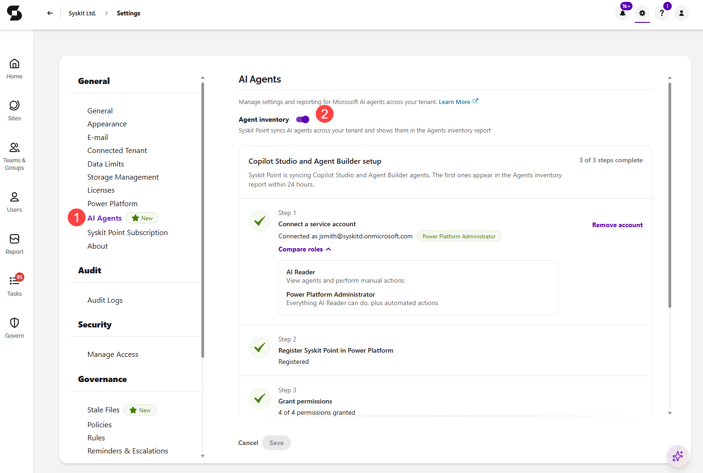
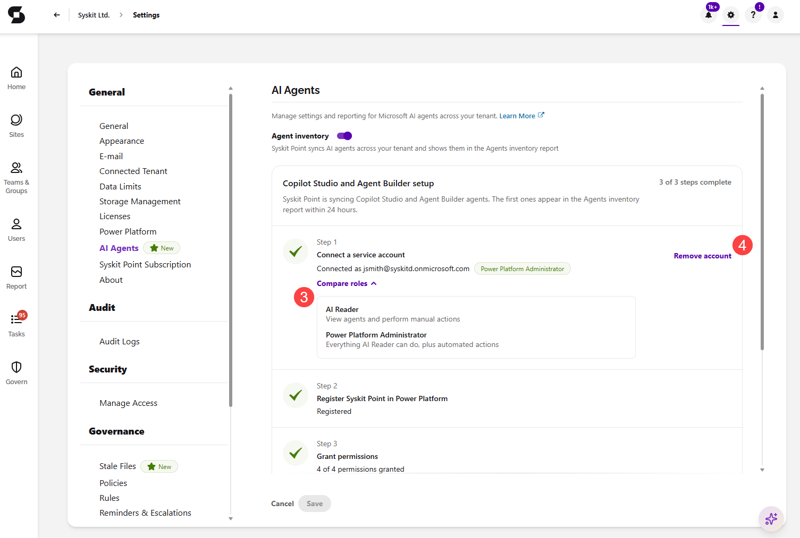

# Configure AI Agents

The setup required to discover **Microsoft agents and Entra apps that can access your Microsoft 365 data** depends on the agent type. For example, Copilot Studio agents require Syskit Point to be registered as a Power Platform management application, while Agent Builder agents require a connected service account. The [Agents Inventory](reports/ai-agents-reports.md#agents-inventory-report) and [Apps Inventory](reports/entra-apps-reports.md#apps-inventory-report) reports help you keep track of these agents and apps.

In this article, you can find details on:

* [Prerequisites](#prerequisites)
* [Setup Requirements by Agent Type](#setup-requirements-by-agent-type)
* [Set Up AI Agents](#set-up-ai-agents)
* [Service Account Explained](#service-account-explained)

## Prerequisites

To set up AI Agents:

* You need the **Global Administrator** role.
* To discover **Agent Builder agents**, you need a **service account** with the **AI Reader** or **Power Platform Administrator** role assigned. Syskit Point accepts only these two roles.
  * **We recommend the AI Reader role** for read-only inventory collection.
  * Some automated agent actions, including the [Ownerless agents automation](ai-agents-and-apps-automation.md), require the **Power Platform Administrator** role.
  * The service account doesn't need the Global Administrator role.
  * The role must be active when the sync runs. If your organization uses PIM, an eligible assignment that hasn't been activated doesn't satisfy this requirement; Syskit Point doesn't activate PIM roles.
* Discovering **Copilot Studio agents** doesn't require a service account. **SharePoint agents** and **Entra apps** sync by default with no additional setup.

## Setup Requirements by Agent Type

The setup steps you need to complete depend on the agents you want to discover:

| Agent type | Requirements |
| --- | --- |
| Copilot Studio agents | Syskit Point [registered in Power Platform](#register-syskit-point-in-power-platform) as a management application |
| Agent Builder agents | A [connected service account](#connect-service-account) with the **AI Reader** or **Power Platform Administrator** role, and the [permissions to discover Agent Builder agents](#grant-permissions) |
| SharePoint agents | No additional setup |
| Entra apps | No additional setup |

If the setup is only partially completed:

* **Without a connected service account**, Copilot Studio and SharePoint agents still sync. The Agent Builder part of the sync fails, and the sync ends as **completed with errors**. Agent Builder agents, their **Blocked** state, and their knowledge sources are missing from Syskit Point.
* **Without registering Syskit Point in Power Platform**, Copilot Studio agents aren't discovered.
* **Without a permission**, you can't use what that permission allows. For example, without the **CopilotStudio.AdminActions.Invoke** permission, you can't block, unblock, or reassign agents in Syskit Point.

## Set Up AI Agents

To set up AI Agents, go to **Settings** and select the **AI Agents section (1)** under **General**.

* **Turn on the Agent inventory toggle (2)**
  * When turned on, Syskit Point syncs the AI agents across your tenant, shows them in the Agents Inventory report, and makes them available for reporting.

Once the toggle is turned on, the **Copilot Studio and Agent Builder setup** section appears. The rest of the AI Agents settings is available only while the Agent inventory toggle is turned on. The setup section guides you through three steps:

1. [Connect a service account](#connect-service-account)
2. [Register Syskit Point in Power Platform](#register-syskit-point-in-power-platform)
3. [Grant permissions](#grant-permissions)

The section header shows your progress, for example, **3 of 3 steps complete**.

### Connect Service Account

Syskit Point signs in with the **service account** connected in the AI Agents settings to read Agent Builder agents across your tenant. The account **must have the AI Reader or Power Platform Administrator role**, and **we recommend the AI Reader role**.

* **We recommend connecting a service account dedicated to AI Agents**, separate from the service account Syskit Point uses to collect the rest of your tenant data.
  * This way, each service account has a single purpose, which is often required by company security policies.
* **Click Connect account** and sign in with the service account.
  * The sign-in is completed without leaving the Settings screen.
* Once connected, the step shows the **connected account** and its **assigned role**.
  * **Click Compare roles (3)** to see what each role allows:
    * **AI Reader** - provides read-only access for Agent Builder inventory collection. It doesn't grant permissions to the user who runs manual actions.
    * **Power Platform Administrator** - everything the AI Reader role allows, plus automated actions, such as the [Ownerless agents automation](ai-agents-and-apps-automation.md)
  * If the account has neither role, the step shows **Missing role**, with a link to assign the role in Microsoft Entra.
* **Click Remove account (4)** to disconnect the service account from AI Agents.
  * Once removed, Agent Builder agents, their **Blocked** state, and their knowledge sources stop syncing. Copilot Studio and SharePoint agents continue to sync.
  * The service account connected in the **Connected Tenant** section of Settings is not affected.

:::info

**Already using AI Agents?** You don't need to connect a new service account. The service account you previously connected is automatically used for AI Agents, and your agent data continues to sync without interruption.

:::

### Register Syskit Point in Power Platform

Registering Syskit Point as a **Power Platform management application** lets Syskit Point read Copilot Studio agents across your tenant. A Global Administrator must approve the registration.

* Once registered, the step shows the **Registered** status with a green checkmark next to it.

### Grant Permissions

The grant action requests the permissions below together; the setup doesn't provide a separate selector for each permission. The descriptions explain what each permission supports. The step shows how many permissions are granted, for example, **4 of 4 permissions granted**.

**To discover Agent Builder agents**, grant the following permissions:

* **Power Platform API/ResourceQuery.Resources.Read** - lets Syskit Point query Agent Builder agents across your tenant
* **Power Platform API/CopilotStudio.MinimalBot.ReadWrite** - lets Syskit Point read the knowledge sources of Agent Builder agents

**To complete [agent actions](ai-agents-and-apps-actions.md)** in Syskit Point, grant the following permissions:

* **Dynamics CRM/user_impersonation** - lets Syskit Point delete Copilot Studio agents
* **Power Platform API/CopilotStudio.AdminActions.Invoke** - lets Syskit Point block, unblock, reassign, and delete agents

**Click Save** to store your preferences.

[Take a look at the Permission Requirements article for more details on why each permission is needed.](../requirements/permission-requirements.md#ai-agents)

Once AI Agents is configured, the first **AI Agents & apps data sync** starts, and the first agents appear in the Agents Inventory report within 24 hours. When the sync is completed, the summary data shows on the [AI & app governance Dashboard tile](ai-agents-and-apps-dashboard-tile.md). From there, you can drill down to the Agents Inventory and Apps Inventory reports for a detailed overview of the agents and Entra apps in your tenant.

## Service Account Explained

**Why the current Syskit Point setup uses a service account:** the **ResourceQuery.Resources.Read** and **CopilotStudio.MinimalBot.ReadWrite** permissions are delegated scopes, and Syskit Point's Agent Builder discovery and knowledge-source collection calls use tokens for the connected service account. The account provides the signed-in user context and required Power Platform role for those calls. Syskit Point's current collection path doesn't use an app-only identity, such as a service principal or managed identity, for Agent Builder agents.

Microsoft documents both user and service-principal authentication for Power Platform APIs generally ([authentication options](https://learn.microsoft.com/en-us/power-platform/admin/programmability-authentication-v2)). This requirement describes Syskit Point's current Agent Builder collection path, not a claim that Microsoft APIs can never support another identity model. Copilot Studio discovery uses a separate Power Platform management application registration and doesn't require this service account.

The connected account is used as an identity for Power Platform API calls. Agent discovery doesn't access its mailbox or read user conversations.

### Collected Data

**Through the service account, Syskit Point collects:**

* **Agent Builder agent inventory** - name, identifier, owner and creator, creation and modification dates, and status, including the **Blocked** state
* **Knowledge sources of Agent Builder agents** - for example, the SharePoint sites and files an agent is grounded on, so the Agents Inventory report can show what content each agent can reach

**Syskit Point doesn't collect:**

* User conversations or chat content
* The content of the knowledge sources; Syskit Point only records which sources an agent references

### Least Privilege Recommendations

To follow the principle of least privilege:

* **Assign the AI Reader role** to the service account. This role is read-only.
* **Use a dedicated account** that isn't used for day-to-day work. Connecting it requires signing in; the Microsoft authentication flow supports MFA. For details, see [Connect Service Account](../configuration/connect-service-account.md).
* Syskit Point uses this account for Agent Builder inventory collection and for automated agent actions that run under the service account. Manual actions run with the permissions of the signed-in Syskit Point user.
* The settings grant action requests all the listed permissions together. The permission descriptions explain which collection or actions use each one; see [Permission Requirements](../requirements/permission-requirements.md#ai-agents) for details.

## Related Articles

* [AI Agents Overview](ai-agents-and-apps-overview.md)
* [AI & app governance Dashboard tile](ai-agents-and-apps-dashboard-tile.md)
* [AI Agents Reports](reports/ai-agents-reports.md)
* [Entra Apps Reports](reports/entra-apps-reports.md)
* [AI Agents Actions](ai-agents-and-apps-actions.md)
* [Ownerless Agents Automation](ai-agents-and-apps-automation.md)
* [Connect Service Account](../configuration/connect-service-account.md)
* [Permission Requirements](../requirements/permission-requirements.md#ai-agents)
* [Permission Requirements Change Log](../requirements/permission-requirements-change-log.md)