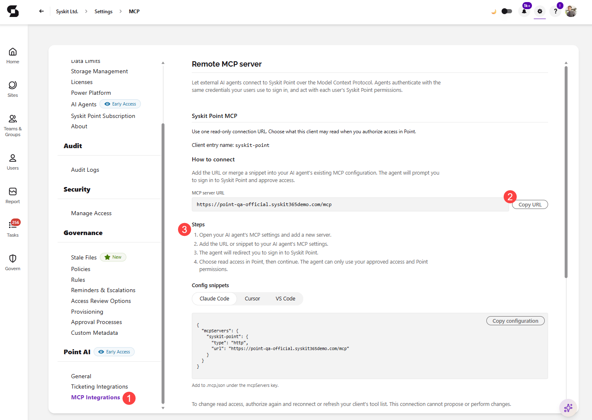
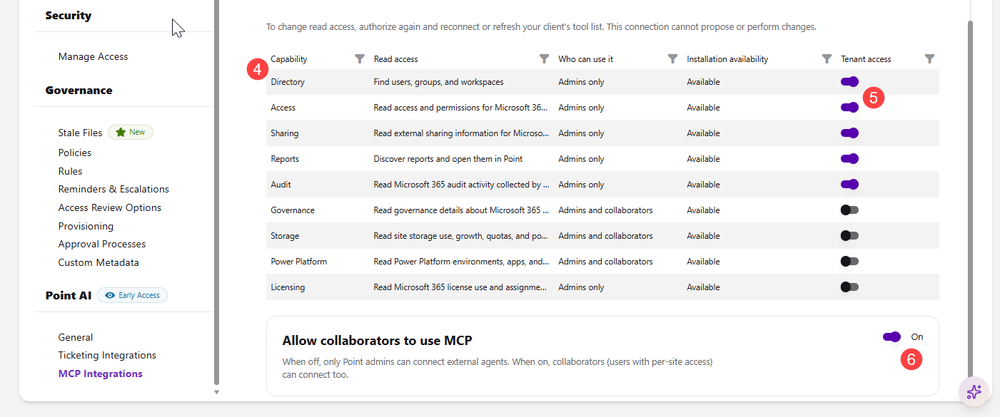
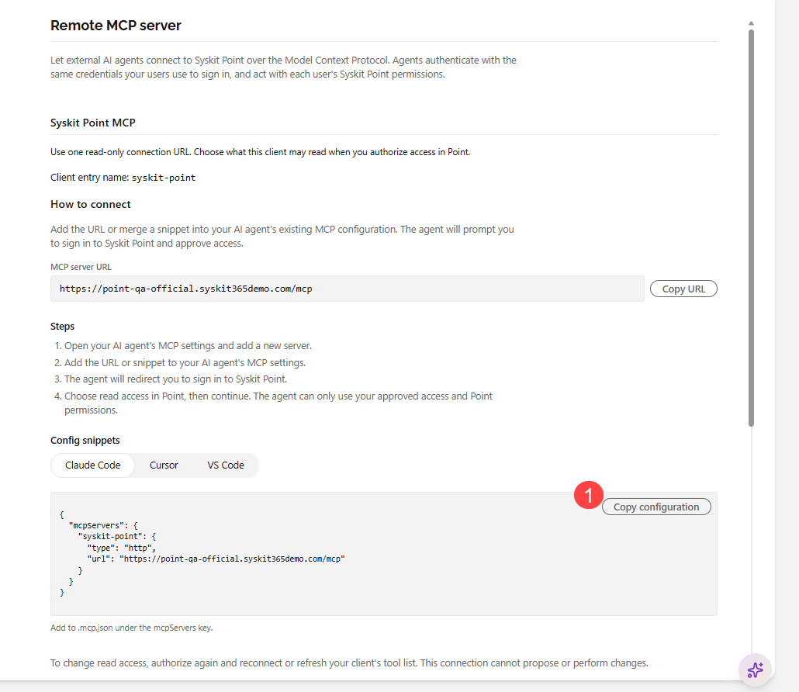

# Syskit Point MCP Server

:::info

**This feature uses LLM functionality which means admin opt-in required.** Take a look at the [AI Data Privacy & Security](../ai-data-privacy-and-security.md) and [Enable AI features](../enable-ai-features.md) articles for more details.

:::

**The Syskit Point MCP Server lets you query your Microsoft 365 governance data directly from any AI tool that supports the Model Context Protocol (MCP)**:
* Microsoft Copilot 
* Claude, or 
* Custom agents you build 

## Prerequisites

* AI features are [enabled](../enable-ai-features.md) in Syskit Point.
* Setting up the MCP Server requires the **Syskit Point Admin** role.
* An MCP-compatible AI tool that supports **remote HTTP MCP servers with OAuth**.

## Capabilities 

The Syskit Point MCP Server offers the following capabilities:

* **Directory** - find users, groups, and workspaces.
* **Access** - read access and permissions for Microsoft 365.
* **Sharing** - read external sharing information for Microsoft 365.
* **Reports** - discover reports and open them in Syskit Point, such as external sharing, ownerless groups, excessive storage, "which resources can this user access."
  * The MCP Server helps you discover the right report and provides a link to open it in Syskit Point. 
  * Running arbitrary reports and exporting report data are not supported.
* **Audit** - read Microsoft 365 audit activity: user and admin activity, file and sharing events, membership changes, within a date range.
* **Governance** - read governance details about Microsoft 365.
* **Storage** - read site storage use, growth, and quotas, including version-cleanup opportunities across the tenant.
* **Power Platform** - read Power Platform environments, apps, flows, connections, and their ownership risks.
* **Licensing** - read Microsoft 365 license use and assignments.

The **MCP Server is read-and-report** only: it **delivers findings and report results**, and does not expose administrative write actions in your tenant. 
  * Queries return only data the connecting identity is allowed to view under Point's permission model, within Point's sync scope and your audit retention period.

## Set up the MCP Server

* In Syskit Point, go to **Settings** > **Point AI** > **MCP Integrations (1)**.
* As instructed on screen, paste the provided server URL (2) into any MCP-compatible AI agent.
  * The agent will walk you through signing in to Syskit Point.
  * The agent can only use your approved access and Point permissions.
  * Follow the Steps (3) listed on screen if you are unsure.
* **Select the capabilities (4)** you want to make available to connected AI tools and **turn the toggle on (5)** next to the capability you want to include.
  * **Directory**, **Access**, **Sharing**, **Reports**, and **Audit** are turned on by default.
  * **Governance**, **Storage**, **Power Platform**, and **Licensing** are turned off by default.
* Optionally, you can also turn on the ***Allow collaborators to use MCP*** **toggle (6)** to let Syskit Point Collaborators connect their AI tools as well. 
  * For more details, see the [Collaborator Access](#collaborator-access) section.

## Connect Your AI Tool

To connect your AI tool, you only need the MCP server URL. No admin-issued credential is required. 

* Open your AI tool's MCP settings and add a new server.
* Paste the MCP server URL as the server address.
* The AI tool redirects you to sign in to Syskit Point.
* **Choose the capabilities** the AI tool can use and approve consent.
  * Once you approve consent, the AI tool can query Syskit Point using your permissions.

* **Claude** - add a custom connector: **Settings** > **Connectors** > **Add custom connector**, paste the MCP server URL, and sign in to Syskit Point. You can test it after with a prompt: *"Using Syskit Point, list ownerless groups."*
* **Microsoft Copilot Studio** - add a new tool of type **Model Context Protocol** pointing to the Syskit Point MCP server URL, configure authentication, and publish to the users or agents who need governance data.
* **Custom agents** - any MCP-compatible framework that supports remote HTTP MCP servers with OAuth can connect using the MCP server URL; list the available tools on connection to discover the capability surface programmatically.

The **configuration snippets (1)** are located in **Settings** > **Point AI** > **MCP Integrations** for Claude Code, Cursor, and VS Code.  

## Consent

Access to the MCP Server is approved on two levels:

* **Admins choose the available capabilities.** 
  * On the **MCP Integrations** page, a Syskit Point Admin selects which capabilities AI tools can use.
* **Users approve access for their AI tool.** 
  * When signing in from the AI tool, each user chooses which of the capabilities enabled by the admin the AI tool can use.

:::info

**Please note:** To change which capabilities your AI tool can use, authorize again and reconnect, or refresh your AI tool's tool list. 
  * This also applies when an admin enables additional capabilities later.

:::

## Collaborator Access

When the ***Allow collaborators to use MCP*** toggle is off, only Syskit Point Admins can connect AI tools. When it is on, Syskit Point Collaborators can connect their AI tools too.

* Collaborator access to the MCP Server requires only the ***Turn on Point AI*** setting to be enabled.
  * The ***Enable Point AI for collaborators*** checkbox does not control collaborator access to the MCP Server.
* Collaborators can use only the capabilities marked **Admins and collaborators** in the **Who can use it** column: **Governance**, **Storage**, and **Power Platform**.
  * The capability also needs to be turned on under **Tenant access**. These three capabilities are turned off by default.
  * All other capabilities are available to Syskit Point Admins only.

Collaborator access **does not grant tenant-wide visibility**. Collaborators work within the limits of their [Syskit Point Collaborators role](../../configuration/enable-role-based-access.md#syskit-point-collaborators):

* Searches return only users the collaborator is allowed to see.
* Restricted operations remain blocked.

## Manage Access

In Syskit Point, go to **Settings** > **Point AI** > **MCP Integrations** to:

* **Change the available capabilities:** turn capabilities on or off under **Tenant access**.
  * Users need to authorize again and reconnect, or refresh their AI tool's tool list, to use newly enabled capabilities.
* **Turn collaborator access on or off:** use the ***Allow collaborators to use MCP*** toggle.

To turn off all MCP Server access, [disable Point AI](../enable-ai-features.md#disable-point-ai). Connected AI tools lose access immediately.

## Early Access Status

The **MCP Server is in Early Access and under active development**. If a query fails or returns unexpected results, share it when the product team reaches out for feedback. **MCP feedback is a top priority** right now.
