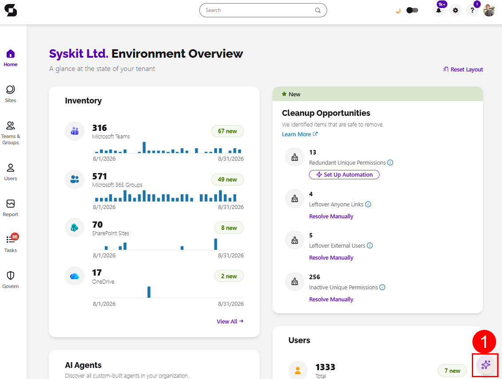
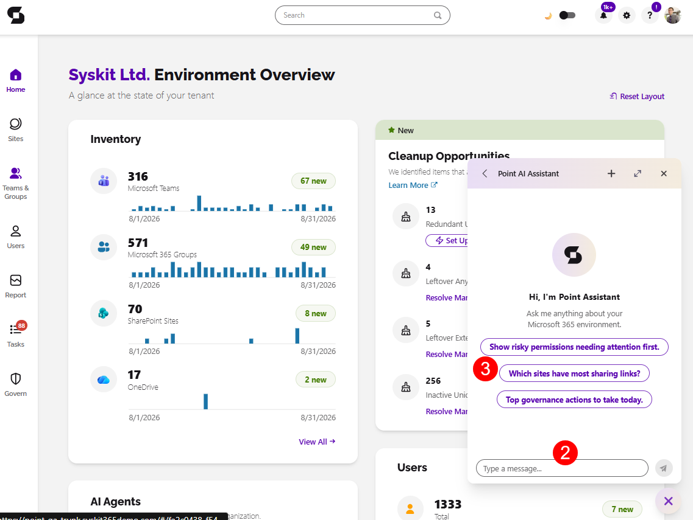
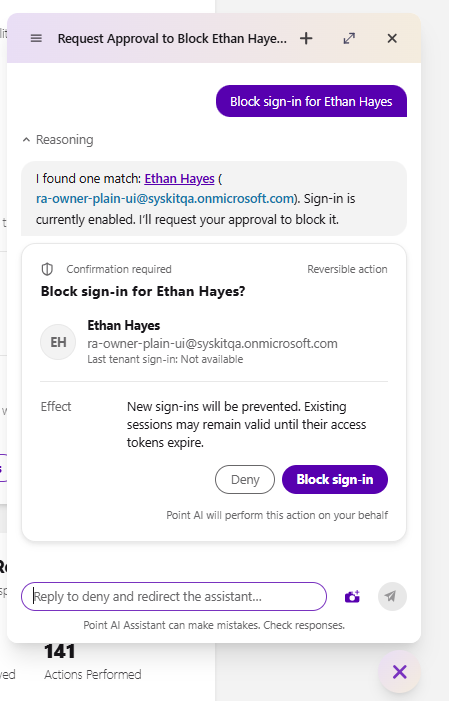
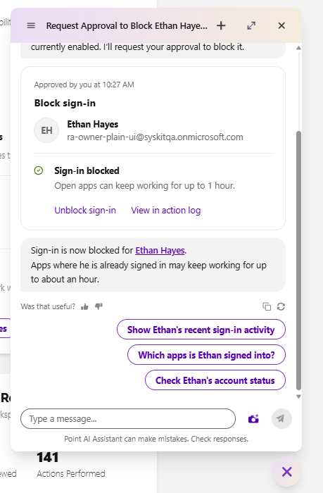

# Point Assistant

:::info

**This feature uses LLM functionality which means admin opt-in required.** It is off by default; processing runs through Microsoft Foundry (Azure-hosted models) in your selected Azure region, and your data is never used to train the foundation models. Take a look at the [AI Data Privacy & Security](../ai-data-privacy-and-security.md) and [Enable AI features](../enable-ai-features.md) articles for more details.

:::

**Finding out who has access to what, why a user is risky, or what an account has been doing normally means knowing which report to run** and where each setting lives. With dozens of reports available, it can take a while to find the right one.

Point Assistant lets you ask these everyday governance questions in plain language. It answers from Syskit Point's own data - audit logs, users, workspaces, permissions, and reports - so instead of searching through dashboards, you simply have a conversation.

## Prerequisites

* Point AI is [enabled](../enable-ai-features.md) in Syskit Point.
* You have access to Syskit Point.
  * Syskit Point Collaborators can use Point Assistant only if the ***Enable Point AI for collaborators*** checkbox is selected. See [Enable AI Features](../enable-ai-features.md#enable-point-ai).
  * Point Assistant answers within the limits of your Syskit Point role and never shows you data your role can't access.

## Open Point Assistant

To start using Point Assistant, complete the following:

* In Syskit Point, **click the Point Assistant icon (1)** in the bottom-right corner.
* **Type your question (2)** in plain language; no special syntax is needed.
  * Alternatively, **select one of the suggested prompts (3)**.

### Start from the Home Dashboard

On the Home dashboard, a compact prompt rotator shows suggested questions that change every 8 seconds. **Click a prompt** to send it to Point Assistant. Hover over the prompt or focus it with the keyboard to show the previous, next, and pause/resume controls.

## Example Questions

Point Assistant covers users, groups and teams, SharePoint sites, storage, audit activity, Syskit Point reports, and Power Platform.

To get a feel for how it works, try asking the following:

* *"Which groups and sites can Eva Green access?"*
* *"Who owns the Marketing team?"*
* *"Show inactive SharePoint sites."*
* *"Who deleted (file name) last week?"*
* *"Find sites nearing their storage quota and tell me where version cleanup would save the most space."*
* *"(User name) is leaving on Friday. Show their groups, sites, apps, flows, and ownership responsibilities."*

## Tips for Better Answers

* **Name the user, site, or group as precisely as you can.**
  * A display name, email address, or sign-in name all work.
* **Include a time range for activity questions.**
  * For example, *"in the last 30 days"* or *"between May 1 and May 25"*.
* **Ask compound questions when you need the full picture.**
  * Point Assistant can combine lookups across users, access, activity, and reports in a single question.

## Block or Unblock User Sign-in

**Point Assistant can also make changes in your tenant, but only after you approve them.** When you ask Point Assistant to complete an action, it shows an **approval card** in the chat, and nothing changes until you approve it.

Currently, Point Assistant supports one action: **blocking or unblocking sign-in for a single Microsoft 365 user**.

* **Block sign-in** prevents the user from signing in to Microsoft 365.
* **Unblock sign-in** allows the user to sign in again.

### Requirements and Limitations

To block or unblock user sign-in through Point Assistant:

* You need the **Syskit Point Admin** role.
  * Without it, Point Assistant declines the request before an approval card appears.
* You need a **Microsoft Entra role that allows you to update users**, such as **User Administrator**.
  * The change is made in Microsoft Entra ID with your own Microsoft 365 permissions.
  * Blocking users who have an admin role assigned might require a higher-privileged Microsoft Entra role.

Keep in mind the following limitations:

* **One user per request** - bulk actions aren't supported.
* **You can't block your own account.**
* **Every action needs a separate approval** - approvals aren't remembered for later requests.
* **Actions are available only in the Point Assistant chat in Syskit Point.**
  * They aren't available through the [Syskit Point MCP Server](mcp-server.md) or [Ticketing Integrations](ticketing-integrations.md).

### Approve the Action

To block or unblock sign-in for a user, complete the following:

* **Ask Point Assistant** to block or unblock sign-in for a user.
  * For example, *"Block sign-in for Alex Johnson"*.
* **Point Assistant looks up the user.**
  * If more than one user matches, Point Assistant lists them and asks which one you mean.
  * If no user matches, Point Assistant lets you know and stops.
  * If the user is already in the requested state, Point Assistant lets you know in the chat, and no approval card is shown.
* **The approval card appears in the chat** and shows:
  * The user's name, user principal name (UPN), and a link to the user's details in Syskit Point
  * The user's last sign-in to your tenant
  * The change that will be made, for example, **Sign-in: Allowed > Blocked**
  * The effect of the change
  * The **Deny** and **Block sign-in** (or **Unblock sign-in**) buttons
* **Click Block sign-in (or Unblock sign-in)** to approve the change.
  * Once the change is made, the card shows **Succeeded**, and Point Assistant confirms it in the chat.
  * If the user was deleted from Microsoft 365 since the last sync, the card shows that the user no longer exists.

After a successful action:

* **Click Unblock sign-in** on the result to reverse a block, or **click Block sign-in** to reverse an unblock.
  * The reverse action needs a new approval.
* **Click View in action log** to open the matching entry.
  * The entry shows that the action was performed through **Point Assistant**.

:::info

**Please note:** blocking sign-in prevents new sign-ins, but it doesn't end sessions that are already active. Existing sessions can remain valid until their access tokens expire, which by default takes between 60 and 90 minutes.

:::

### Deny or Cancel the Action

Nothing changes in your tenant if you:

* **Click Deny** on the approval card.
* **Send a new message** while the approval card is pending.
  * This cancels the pending card, and Point Assistant continues with your new message.
* **Don't respond within 10 minutes.**
  * The approval card expires; click **Request again** if you still want to complete the action.

### Approval Card States

The approval card can show the following states:

| State | Meaning |
|---|---|
| **Pending** | The action is waiting for your approval. |
| **Executing** | The change is being made. |
| **Succeeded** | The change was made. |
| **Failed** | The change wasn't made, for example, because of a missing permission or because Microsoft 365 rejected it. |
| **Denied** | You denied the action. |
| **Canceled** | You sent a new message while the card was pending. |
| **Expired** | The card wasn't answered within 10 minutes. |
| **Outcome unknown** | The result couldn't be confirmed. Click **Check current state**, or check the user in the Microsoft Entra admin center, before trying again. |

:::info

**Please note,** Point Assistant:

* **Makes changes only with your approval.**
  * Apart from [blocking or unblocking user sign-in](#block-or-unblock-user-sign-in), Point Assistant delivers findings and recommended steps and doesn't make administrative changes. To act on a finding, follow the link to the relevant Syskit Point report.
* **Answers only from Syskit Point data.**
  * Answers reflect data synced into Syskit Point, so very recent changes in your tenant appear after the next sync. Activity answers are limited by your audit log retention period.
  * Point Assistant doesn't answer general knowledge questions.
* **Doesn't make up data.**
  * If the data isn't available, Point Assistant says so instead of inventing records.

:::
