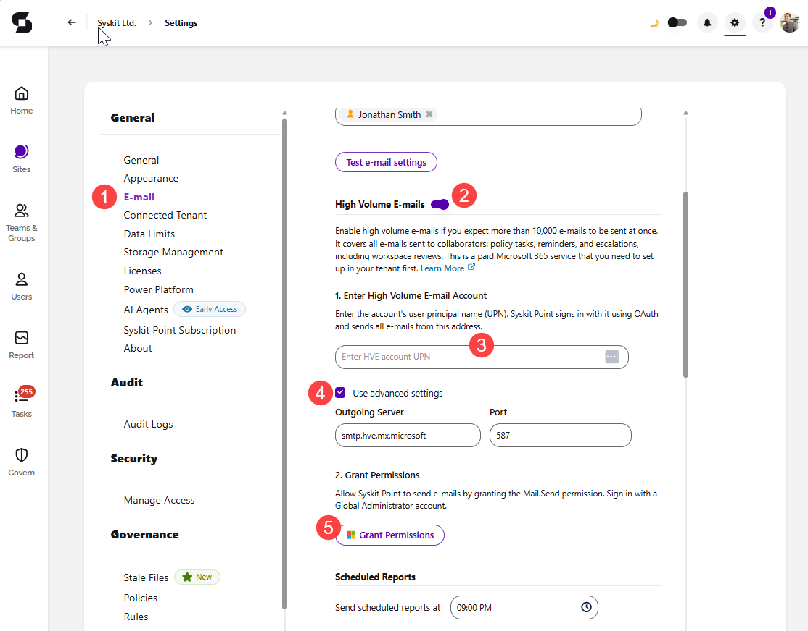

# High Volume E-mails

**High Volume E-mails allow Syskit Point to send a large number of e-mails to collaborators** using Microsoft's High Volume Email (HVE) service. Enable High Volume E-mails if you expect more than 10,000 e-mails to be sent at once.

High Volume E-mails are **not a separate sending method**. They are used alongside the **Exchange Online** or **SMTP** method configured in the [E-mail settings](set-up-email.md). When High Volume E-mails are enabled, only [supported e-mails](#supported-e-mails) are sent through HVE, while all other e-mails are still sent using the selected Exchange Online or SMTP method.

:::warning
**Please note!**\
Only users assigned to the **Syskit Point Admin** role can access and configure Settings in Syskit Point.
:::

High Volume Email is a **paid Microsoft 365 service** that you need to set up in your tenant first. To use High Volume E-mails in Syskit Point, the following needs to be completed:

**In Microsoft 365**, you'll need to:
* **Set up pay-as-you-go billing and create a billing policy** in the Microsoft 365 admin center; an Azure subscription is required
  * [Learn how to set up pay-as-you-go billing and create a billing policy in this Microsoft article.](https://learn.microsoft.com/en-us/microsoft-365/commerce/services/pay-as-you-go-setup-billing-node)
* **Connect the billing policy to the High Volume Email service** in the Microsoft 365 admin center
  * [Learn how to connect a pay-as-you-go service to a billing policy in this Microsoft article.](https://learn.microsoft.com/en-us/microsoft-365/commerce/services/pay-as-you-go-setup-billing-node#connect-a-pay-as-you-go-service-to-a-billing-policy)
* **Create an HVE account and assign the billing policy to it** in the Exchange admin center
  * [Learn how to create an HVE account in this Microsoft article.](https://learn.microsoft.com/en-us/exchange/mail-flow-best-practices/high-volume-mails-m365#create-an-hve-account)
  * The HVE account can send e-mails only when a valid billing policy is assigned to it

**In Syskit Point**, you'll need to:
* **Enable High Volume E-mails, enter the HVE account, and grant permissions** in the [High Volume E-mails settings](#high-volume-e-mails-settings)

## Supported E-mails

When High Volume E-mails are enabled, **the following e-mails are always sent through HVE**:
* **Workspace Review e-mails** sent automatically by Workspace Review policies
* **Reminder and escalation e-mails** for Workspace Review tasks; [learn more about reminders and escalations here](../governance-and-automation/workspace-review/reminders-and-escalations.md)
* **Policy violation e-mails** sent to collaborators when task delegation is enabled for a policy
* **Workspace Review completed e-mails** sent once Workspace Review tasks are completed

The following e-mails **are not sent through HVE** and are still sent using the selected Exchange Online or SMTP method:
* **Manually started reviews**, such as reviews started with the **Start Now** or **Request Workspace Review** actions
* **Scheduled reports** and all other e-mails sent by Syskit Point

:::warning
**Please note!**
* **High Volume Email supports internal recipients only.** E-mails to external recipients can't be sent through HVE; in that case, Syskit Point uses a fallback to make sure the e-mails are still sent.
* **The maximum message size is 10 MB**, and **one message can have up to 50 recipients**.
* **The HVE account can't receive e-mails**, as it doesn't have a mailbox.
* **High Volume Email is billed based on the number of delivered e-mail recipients.**

Learn more about High Volume Email limitations and pricing by taking a look at [this Microsoft article](https://learn.microsoft.com/en-us/exchange/mail-flow-best-practices/high-volume-mails-m365).
:::

## High Volume E-mails Settings

To enable High Volume E-mails in Syskit Point:
* Navigate to Settings > General > **E-mail (1)**
* **Switch the toggle on (2)** next to High Volume E-mails
* Under **1. Enter High Volume E-mail Account**, **enter the user principal name (UPN) of the HVE account (3)**; Syskit Point signs in with it using OAuth and sends supported e-mails from this address
  * **Check the Use advanced settings box (4)** to view or change the **Outgoing Server** (`smtp.hve.mx.microsoft`) and **Port** (`587`)
* Under **2. Grant Permissions**, **click Grant Permissions (5)** and sign in with a **Global Administrator account** to grant Syskit Point the `Mail.Send` permission

## Related Articles

* [Set Up E-Mail](set-up-email.md)
* [Customize E-mails](customize-emails.md)
* [Configure Workspace Review](../governance-and-automation/workspace-review/setup-workspace-review.md)
* [Reminders & Escalations](../governance-and-automation/workspace-review/reminders-and-escalations.md)
