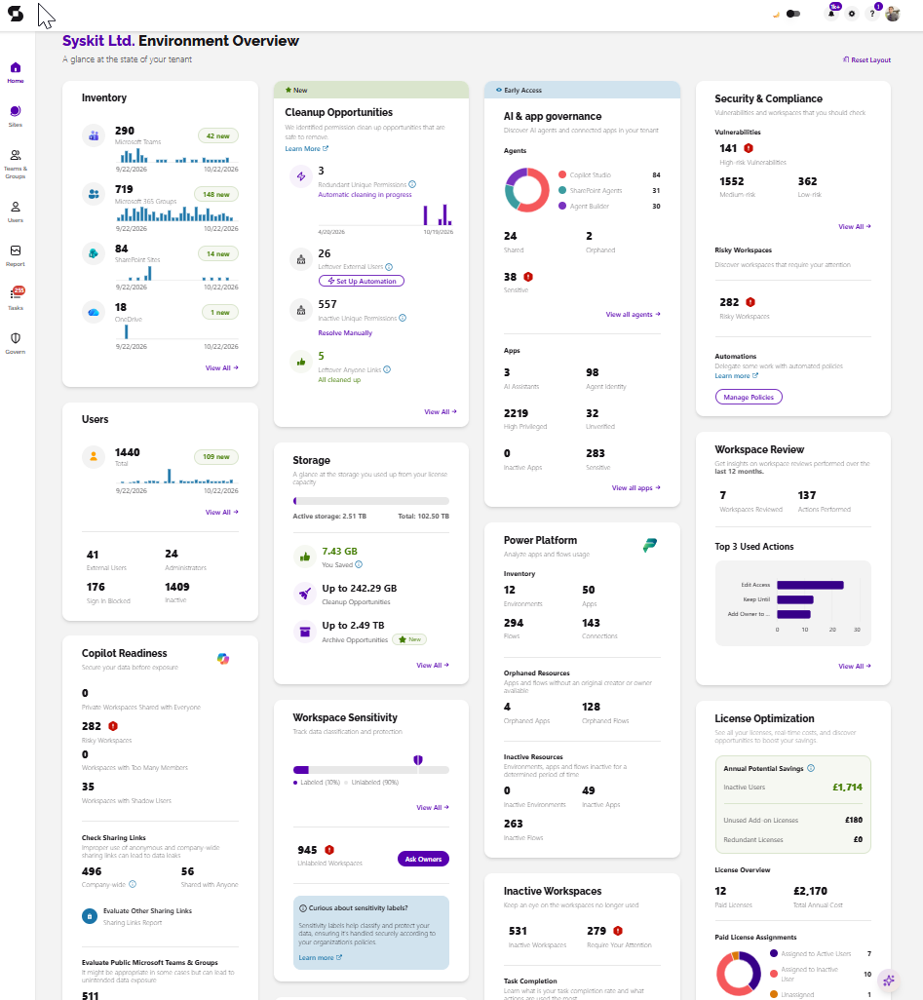
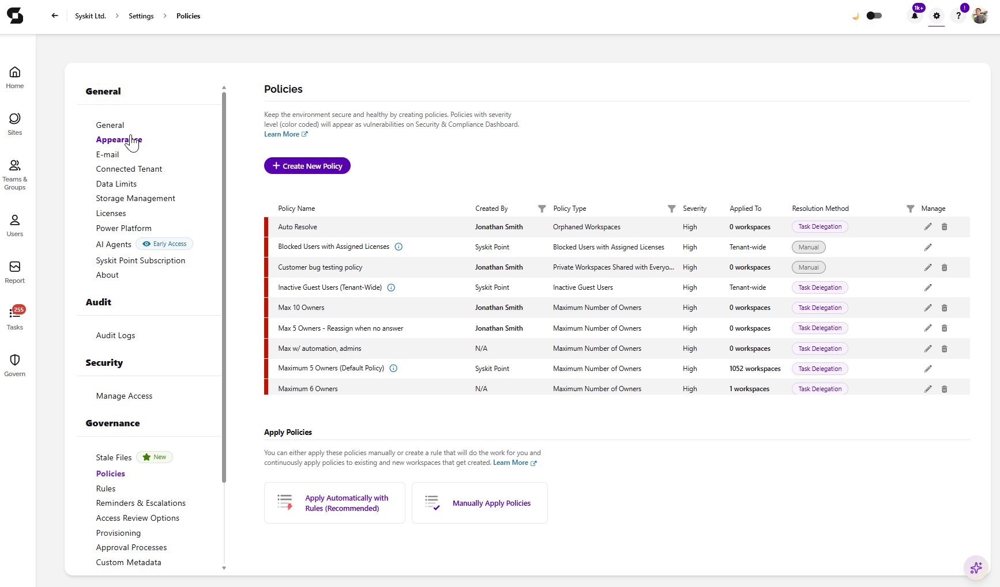
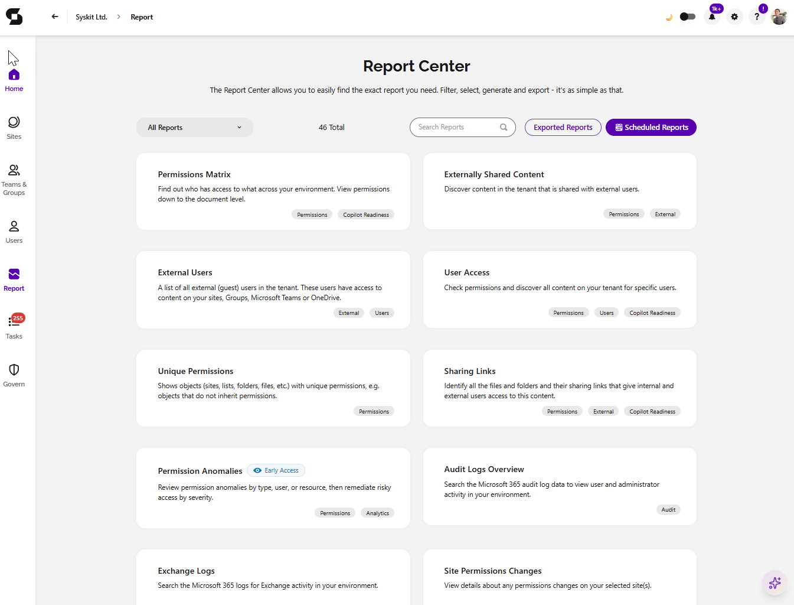

# The Syskit Point Starter Kit

This article walks you through the main areas of Syskit Point and links to the resources you'll need.

Syskit Point is the **governance layer for your Microsoft 365 environment**. It gives you full visibility and keeps your environment under control: secured, cost-optimized, and ready for safe AI adoption. You manage it all from one interface, with less manual work and full coverage of Microsoft 365.

Your path through Syskit Point usually looks like this:

* [**Discover**](#discover-microsoft-365-inventory): See your whole Microsoft 365 environment in one place, including users, Teams, Groups, SharePoint sites, OneDrive, Power Platform, and AI agents.
* [**Control**](#control-automated-governance-and-lifecycle-management): Automate governance and hand responsibility to workspace owners. Manage every workspace from creation to archiving or deletion.
* [**Secure & Comply**](#secure--comply-permissions-access-management-and-audit): Find out who has access to what and stop oversharing. You can also catch risky activity early and stay ready for audits.
* [**Optimize Costs**](#optimize-costs-storage-and-licenses): Cut unnecessary storage and license spend, and see the ROI within minutes.
* [**Enable Safe AI**](#enable-safe-ai-adoption): Know which content AI can reach, keep track of AI agents, and make sure Copilot works with accurate, up-to-date data.

:::warning
**Please note!**\
If you're on a free trial, read about activation, limitations, and setup instructions [here](../set-up-point-cloud/overview.md).
:::

## Discover: Microsoft 365 inventory

No blind spots and no manual scripts. Get a centralized, accurate view of every user and workspace across **Microsoft Teams, Groups, SharePoint, OneDrive, Power Platform, and AI agents**, without moving between admin centers.

### Users Overview

Open the [**Users Overview**](../microsoft365-inventory/users.md) from the home screen to see all your Microsoft 365 users in one place. That includes external users, administrators, inactive users, users with blocked sign-in, and their permissions, so anomalies stand out. You can export the data to PDF or Excel, or schedule it for email delivery.

Select any user to see:

* General user information
* Analytics and usage
* Microsoft Teams and Group memberships
* Every workspace the user can access

### Sites, Microsoft Teams, Groups, and OneDrive Overviews

From the home screen, you can explore and filter your [**Sites**](../microsoft365-inventory/sites.md), [**Microsoft Teams & Groups**](../microsoft365-inventory/microsoft-teams-and-groups.md), and **OneDrive**. Select one or more workspaces to act on them in bulk, or open a single workspace for a detailed view:

* Number of users, external users, anonymous links, and unique permissions
* Content overview with all files in the workspace
* Who has permissions on the workspace

➡ Learn how to [navigate](navigate-through-syskit-point.md) through Syskit Point.

➡ Explore the [Dashboard](../microsoft365-inventory/explore-your-microsoft-365-dashboard.md) to get the full picture of your Microsoft 365 environment.

## Control: automated governance and lifecycle management

Governance should run continuously, not only when IT has time. Syskit Point combines **automated policies with delegated ownership**. IT keeps control and oversight, workspace owners stay accountable, and the environment stays clean without IT bottlenecks or extra headcount.

### [Provisioning](../governance-and-automation/provisioning/)

**Control workspace creation and prevent sprawl.** Set up templates for Teams, Groups, sites, and Viva Engage communities with custom metadata, naming conventions, and governance policies. Make requests simple for end users with customizable approval workflows in the [Syskit Point Teams app](../governance-and-automation/syskit-point-teams-app.md).

### [Workspace reviews](../governance-and-automation/workspace-review/monitor-workspace-review/workspace-review-governance.md)

Define review policies that run on set review cycles. Have workspace owners regularly review memberships, sharing settings, external users, sensitivity, privacy, permissions, and ownership. Give responsibility to the people with the best operational knowledge.

### [Access reviews](../governance-and-automation/permissions-review/)

Automate review requests to content owners. Have owners regularly confirm memberships, sharing, and external users.

### [Governance policies and rules](../governance-and-automation/automated-workflows/README.md)

Re-certify guest users, clean up orphaned workspaces, and enforce ownership best practices automatically.

### [Inactive workspace cleanup](../governance-and-automation/automated-workflows/inactive-workspaces-admin.md)

Detect inactive SharePoint sites, Groups, and Teams. Define whether data is kept, archived, or deleted.

## Secure & Comply: permissions, access management, and audit

Stop oversharing, prevent data leakage, and pass audits without scrambling. Syskit Point offers the most granular, actionable permission reporting for Microsoft 365, and you can act on what you find directly from the reports.

### Generate reports

Generate reports in one click. **Export them, or schedule them** for delivery to any inbox or SharePoint library, so audit-ready reports are always available.

Report categories include:

* [**Permissions**](../reporting/access-reports.md): See who has access to what across Microsoft 365. Drill down into user permissions and memberships, and find broken inheritance wherever content permissions differ from the parent.
* [**External Sharing**](../reporting/external-sharing-reports.md): Find all external users and guests, externally shared content, and sharing links, and bring excessive sharing under control.
* [**Cleanup**](../reporting/cleanup-and-health-reports.md): Find Microsoft 365 Groups and Teams with disabled or deleted owners and assign new ones. Identify and remove orphaned users.

### Access Management

Act on risks as soon as you find them, **one at a time or in bulk**, directly from reports:

* **Manage user permissions** from one central place. Offboard people who leave or change departments, and **add, copy, or transfer** permissions for multiple users at once.
* Remove risky **sharing links**, including anonymous links, and **manage external users** and guests.
* Manage Teams and Groups **membership and ownership**.
* **Restore permissions inheritance** on items with unique permissions.

➡ Learn how to use [Access Management](../access-management/).

### [Security and compliance checks](../governance-and-automation/security-compliance-checks/README.md)

Run automated checks on users, files, permissions, and sensitivity labels to support ISO, HIPAA, and GDPR requirements. You stay compliant and can prove it.

### Auditing and alerts

Every permission, content, and configuration change across SharePoint, Teams, OneDrive, Exchange, and Groups is logged and easy to filter. You can track:

* Sharing of files, folders, sites, teams, or groups
* Breaking or restoring permissions inheritance
* Internal and anonymous sharing links
* Creation or deletion of sites, teams, or groups
* Admin changes and changes to organization-wide settings

Set up [alerts](../governance-and-automation/configure-alerts.md) to get early warnings about critical events and act before threats escalate.

➡ Learn how to [turn on auditing](../configuration/turn-on-auditing.md) in the Microsoft 365 Security & Compliance Center.

➡ Learn how to track [external users](../access-management/track-external-users-and-their-activities.md) and their activity.

## Optimize costs: storage and licenses

Reduce Microsoft 365 spend with no manual effort, and see the ROI within minutes.

* **Storage management**: Quickly clean up sites and file versions, and archive at the site or file level. Storage limit alerts help prevent future bloat.\
  ➡ Learn more: [Storage Management](../storage-management/README.md)
* **License optimization**: Get a full overview of assigned, unassigned, and inactive licenses and their cost. Automated waste detection helps you reclaim redundant licenses, assign them where they're needed, and go into renewals with real data. Available as an add-on.\
  ➡ Learn more: [Licenses reports](../reporting/licenses-reports.md)

## Enable safe AI adoption

AI is only as safe and accurate as the data it can reach. Syskit Point shows where AI could surface sensitive content and helps you fix it before anything is exposed.

* **AI agent inventory**: See your AI agents and assistants in one clear view and manage the lifecycle of AI agents and assistants to reduce agent sprawl and data exposure.\
  ➡ Learn more: [AI Agents](../ai-agents-and-apps/README.md)
* **AI exposure risk overview**: See risky permissions, oversharing, and stale content across all workspaces. Fix them with permission management, lifecycle policies, delegated governance, and archiving.
* **Better AI response quality**: Keep content accurate and up to date so Copilot works with data your teams can trust.

## Set up your Syskit Point

Now that you know what Syskit Point can do, there are a few things to set up before you start.

Follow the instructions in these articles to get started:

* [Set Up E-mail](../configuration/set-up-email.md)
  * [Customize E-mails](../configuration/customize-emails.md)
* [Enable Role-Based Access](../configuration/enable-role-based-access.md)
* [Enable Microsoft Teams Activity Tracking](../configuration/microsoft-teams-activity.md)
* [Ignore Service Account Activity tracking](../configuration/ignore-service-account-activity-tracking.md)
* [Customize Audit Logs collection](../configuration/customize-audit-logs-collection.md)
* [Customize License Reports](../configuration/customize-license-reports.md)
* [Power Platform for Syskit Point](../power-platform/enable-power-platform.md)
