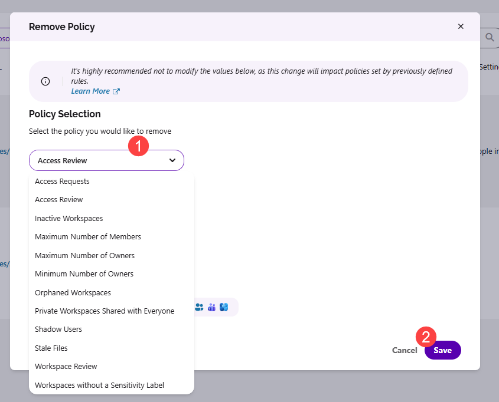

# Migrate from Access Review to Workspace Review

:::warning

**Please note:** Access Review will be retired in January 2027. To continue reviewing your workspaces without interruption, we recommend moving to [Workspace Review](../workspace-review/setup-workspace-review.md) before then.

:::

Workspace Review is a completely new feature in Syskit Point, and it is **not connected to Access Review in any way**. This means that **both features can be used at the same time**.

This makes the transition simple: you can **set up Workspace Review first** and **turn off Access Review only when you're ready**.

Here's a quick overview of what the migration from Access Review to Workspace Review looks like:

* **Test Workspace Review**
  * As with Access Review, we recommend testing Workspace Review on a small number of workspaces first
* **Configure Workspace Review e-mails**
  * Customize the e-mails sent to reviewers, as described in the [Customize E-mails article](../../configuration/customize-emails.md#customize-workspace-review-e-mail)
* **Create Workspace Review policies and apply them to workspaces**
  * Replicate your current Access Review configuration, as described in the [Create Workspace Review Policies](#create-workspace-review-policies) and [Apply Workspace Review Policies](#apply-workspace-review-policies) sections
* **Turn off Access Review**
  * Remove Access Review policies from your workspaces and delete them, as described in the [Delete Access Review Policies](#delete-access-review-policies) section

In the sections below, you can find detailed instructions on how to replicate your current Access Review configuration in Workspace Review.

## Create Workspace Review Policies

First, create Workspace Review policies and configure them depending on your needs. When creating a policy, you can define:
* **What to review**
* **How often to review**
* **Who performs the review** for each workspace type

:::info

**Use your current Access Review policies as a starting point.** Check their settings and create Workspace Review policies that match them.

:::

For a detailed explanation of how to create Workspace Review policies, take a look at the [Configure Workspace Review article](../workspace-review/setup-workspace-review.md).

## Apply Workspace Review Policies

How you apply Workspace Review policies depends on how you applied your Access Review policies:
* [**Automatically with Rules**](#if-you-applied-access-review-policies-with-rules)
* [**Manually**](#if-you-applied-access-review-policies-manually)

### If You Applied Access Review Policies with Rules

To replace Access Review policies in your rules, take the following steps:

* **Navigate to Settings > Governance > Rules**
* **Open the Edit Rule dialog** for each rule that applies an Access Review policy
* In the Apply Policies step of the dialog, **replace any Access Review policy with the corresponding Workspace Review policy** and **click Save**

[For a detailed explanation of how Rules work and how to set them up, please read through the Rules article.](../automated-workflows/policy-automation.md)

### If You Applied Access Review Policies Manually

To apply Workspace Review policies to the same workspaces, take the following steps:

* **Navigate to Settings > Governance > Policies** and **click the Manually Apply Policies button**
   * This opens the Manage Policies screen, where you can see a list of all the workspaces in your environment with policies assigned to them
* **Click the Access Review tile** at the top of the screen
   * The report now only displays workspaces with an Access Review policy applied
* **Filter the Policies Applied column** and select one of your Access Review policies
* **Select all workspaces** in the grid
* **Click the arrow next to the Manage Policies button**, located on the right side of the screen, and **select Apply Policy**
* In the dialog that opens, **select Workspace Review** from the first drop-down menu, **select the policy** from the second drop-down menu, and **click Save**
* **Repeat the steps above**, starting from filtering the Policies Applied column, for each Access Review policy

Once the Workspace Review policies are applied, **remove the Access Review policies from your workspaces** by taking the following steps:

* **Click the Access Review tile** at the top of the screen and **select all workspaces** in the grid
* **Click the arrow next to the Manage Policies button**, located on the right side of the screen, and **select Remove Policy**
* In the Remove Policy dialog, **select Access Review (1)** from the drop-down menu and **click Save (2)**

For more details on manually applying policies, take a look at the [Apply Policies article](../automated-workflows/manage-policies.md#apply-manually).

## Delete Access Review Policies

Before deleting Access Review policies, **make sure they are not applied to any workspace**:

* **Navigate to Settings > Governance > Policies**
* **Check the Applied To column** for each Access Review policy
  * The value must be **0**

If any Access Review policy is still applied, take the following steps:

* **Click Sites** on the Syskit Point homepage and **filter the Policies Applied column** by the Access Review policies that are still applied to workspaces
  * These are the policies with an **Applied To** value greater than **0** from the previous step
* **Open each workspace** with the Access Review policy applied
* **Remove the Access Review policy** and **apply the corresponding Workspace Review policy**

Once an Access Review policy is no longer applied to any workspace, you can **delete it** on the **Settings > Governance > Policies** screen.

Access Review and Workspace Review are separate features with separate policies, so **you can use both at the same time** while you transition.

:::info

To check which workspaces have Access Review or Workspace Review policies applied, navigate to **Settings > Governance > Policies** and **click the Manually Apply Policies button**. **Click the Access Review or Workspace Review tile** to display only the workspaces with that policy type applied.

:::
